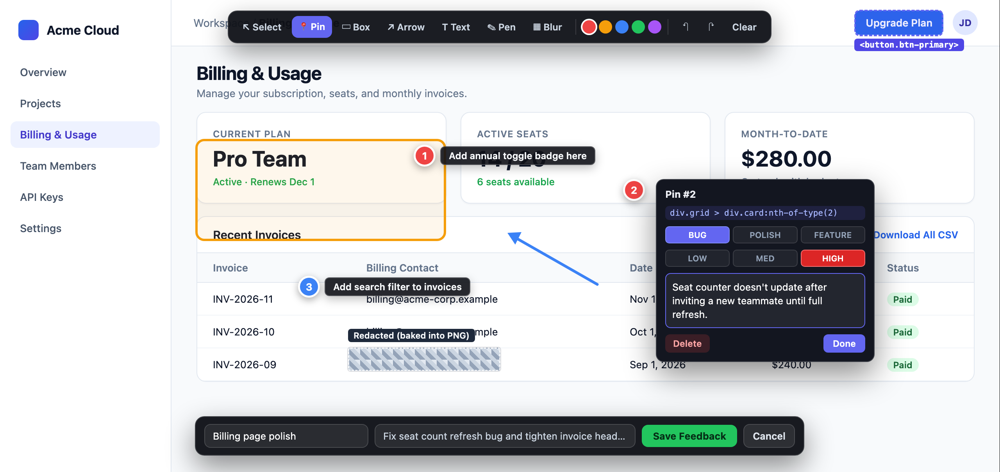
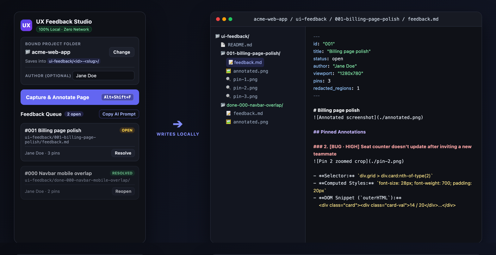

<div align="center">


# UX Feedback Studio

**Point. Annotate. Ship fixes faster.**  
Turn live webpage screenshots and visual markups into AI-ready Markdown—saved straight to your local project folder with **zero cloud uploads**.


</div>

---

## Stop describing UI bugs in paragraphs. Just point at them.

Whether you're **vibe coding with an AI agent** (Claude Code, Cursor, Antigravity, Codex, Copilot) or doing a **design/QA review with your team**, typing out *"the button in the top right of the billing card looks slightly misaligned and overlaps the badge on smaller screens"* is slow and ambiguous.

**UX Feedback Studio** lets you freeze any webpage or local app right in Chrome, drop numbered pins, boxes, arrows, text callouts, and blur redactions on top of it, and hit **Save**. Behind the scenes, it writes a clean folder directly onto your machine with:
* Your annotated full-page screenshot (`annotated.png`)
* **Zoomed-in crops** around every pin (`pin-1.png`, `pin-2.png`, …)
* A structured **`feedback.md`** containing your notes, bug/polish/feature tags, severity, exact CSS selectors, computed CSS styles, `outerHTML`, theme attributes, and console errors.

Then click **Copy AI Prompt**, paste it into your coding agent, and watch it fix every item in one pass.



---

## How It Works (in 30 Seconds)

1. **Bind any local folder once** in the Chrome Side Panel (for example, your app's repo).
2. **Press `Alt+Shift+F`** (or click **Capture & Annotate Page**) on any website, `localhost` app, staging site, or modal popup.
3. **Mark up the page** with pins, boxes, arrows, callouts, pen strokes, or blur/redactions—then click **Save Feedback**.
4. **Everything lands directly on disk** inside `<your-folder>/ui-feedback/001-<slug>/`. Point your AI agent (or teammate) at the folder and go.



---

## Why Teams & Vibe Coders Use It

| | What You Get |
| :--- | :--- |
| 🔒 **Zero Data Retention (ZDR)** | **Zero network calls.** Enforces `connect-src 'none'` at the Chrome engine level—no accounts, no cloud servers, no telemetry. Safe for internal tools, staging environments, and proprietary apps. |
| 🎯 **Built for AI Coding Agents** | Every pin automatically captures the underlying **CSS selector**, **computed styles**, **real `outerHTML`**, **zoomed HiDPI crop**, **theme `data-*` attributes**, and **console errors**—so your agent knows *exactly* what to fix without guessing. |
| ▦ **Destructive Redaction** | Blur out emails, customer names, or API keys before saving. Redactions are pixelated directly into both `annotated.png` and every `pin-N.png` crop—no unredacted screenshot ever touches disk. |
| 🪟 **Works Over Modals & Popups** | Automatically promotes itself into Chrome's **Top Layer** so you can annotate native `<dialog>` modals, drawers, and popovers—not just flat pages. |
| ⚡ **Zero Setup, Zero Dependencies** | Pure vanilla HTML, CSS, and ES modules. No `npm install`, no build step, no background daemon or MCP server required. |

---

## Quick Start (2 Minutes)

1. **Clone or download** this repository to your computer.
2. Open **`chrome://extensions`** in Google Chrome.
3. Turn on **Developer mode** (top-right toggle).
4. Click **Load unpacked** and select this folder.
5. Pin **UX Feedback Studio** to your Chrome toolbar and click it to open the Side Panel.

> **First time binding a folder:** Click **Bind Folder** in the Side Panel and choose your project directory. *(Chrome asks for a quick one-click **Reconnect** after a full browser restart to restore write access.)*

---

## Annotation Tools & Shortcuts

Press **`Alt+Shift+F`** on any tab to launch the overlay, then use the toolbar or keyboard shortcuts:

| Shortcut | Tool | What It Does |
| :--- | :--- | :--- |
| `V` or `0` | **↖ Select** | Click any annotation to select, drag to move, drag corner/endpoint handles to resize Boxes/Blurs/Arrows, click a color swatch to recolor, or press `Delete`/`Backspace` to remove. Dragging a Pin automatically re-inspects the DOM at its new spot. |
| `1` | **📍 Pin** | Hover to highlight live DOM elements; click to drop a numbered pin with a note, **Type** (`Bug` / `Polish` / `Feature`), and **Severity** (`Low` / `Med` / `High`). Exports a zoomed crop + CSS selector, computed styles, and `outerHTML`. |
| `2` | **▭ Box** | Draw rectangles to call out regions or layout blocks. |
| `3` | **↗ Arrow** | Point directly at alignment or spacing issues. |
| `4` | **T Text** | Place high-contrast text labels right on the screenshot. Double-click any label to edit or delete it. |
| `5` | **✎ Pen** | Freehand sketch or mockup. |
| `6` | **▦ Blur** | Pixelate sensitive data (destructively baked into all saved PNGs). |
| `Cmd/Ctrl + Z` | **Undo** | Undo draws, moves, resizes, recolors, text edits, and deletions. |
| `Cmd/Ctrl + Shift + Z` | **Redo** | Redo undone actions. |
| `Cmd/Ctrl + Enter` | **Save** | Save everything straight to `<folder>/ui-feedback/00X-<slug>/`. |
| `Esc` | **Close** | Closes open popover → deselects active item → exits overlay. |

---

## Output Structure & Markdown Format

On first save, UX Feedback Studio creates a `ui-feedback/` folder inside your bound directory along with an auto-generated `ui-feedback/README.md` explaining the conventions to any AI agent (never overwritten if you customize it):

```text
<your-project-folder>/
└── ui-feedback/
    ├── README.md                     # Auto-generated agent & git tracking guide
    ├── 001-billing-page-polish/      # Open feedback item
    │   ├── feedback.md               # Notes, metadata, CSS selectors, styles & DOM
    │   ├── annotated.png             # Full viewport screenshot with annotations
    │   ├── pin-1.png                 # Zoomed HiDPI crop for Pin #1
    │   └── pin-2.png                 # Zoomed HiDPI crop for Pin #2
    └── done-000-navbar-overlap/      # Completed feedback item
        ├── feedback.md
        └── annotated.png
```

<details>
<summary><strong>See a full example <code>feedback.md</code></strong></summary>

```markdown
---
id: "001"
title: "Billing page polish"
status: open
author: "Jane Doe"
created_at: "2026-11-23T17:40:54.998Z"
url: "http://localhost:3000/billing"
page_title: "Billing & Usage — Acme Cloud"
viewport: "1280x780"
pins: 2
build: "app-build=v1.4.2 (main@a1b2c3d)"
redacted_regions: 1
---

# Billing page polish


## Summary

Fix seat count refresh bug and tighten invoice header spacing.

## Page Context & Environment

- **Author:** Jane Doe
- **URL:** http://localhost:3000/billing
- **Page Title:** Billing & Usage — Acme Cloud
- **Viewport:** `1280x780` (DPR: 2)
- **Color Scheme:** `light`
- **App Meta Tags:**
  - `app-build`: `v1.4.2 (main@a1b2c3d)`
- **Root Data Attributes (Theme / Variant):**
  - `html.data-primary`: `indigo`
  - `html.data-density`: `comfortable`

## Pinned Annotations

### 2. [BUG · HIGH] Seat counter doesn't update after inviting a new teammate until full refresh.


- **Selector:** `div.grid > div.card:nth-of-type(2)`
- **Element:** `<div.card>`
- **Text:** "ACTIVE SEATS 14 / 20 6 seats available"
- **Bounding Box:** `x: 590, y: 180, w: 318, h: 128`
- **Computed Styles:** `color: rgb(15, 23, 42); background: rgb(255, 255, 255); font-size: 13px; padding: 20px; border-radius: 12px`
- **DOM Snippet (`outerHTML`):**
  ```html
  <div class="card"><div class="card-label">Active Seats</div><div class="card-val">14 / 20</div></div>
  ```
```

</details>

### Optional App Metadata Hooks
Apps need **zero integration** to work with UX Feedback Studio. However, if your app includes `<meta>` tags matching `build`, `version`, `commit`, `branch`, `release`, `env`, `user`, `role`, or `feedback` (e.g. `<meta name="app-build" content="1.4.2 main@abc123">` or `<meta name="feedback-user" content="Jane Doe · Admin">`), the extension automatically includes them in `feedback.md`.

### Git Tracking Policy (`.gitignore` vs. Shared QA)
* **Personal local loop (Default):** Add `ui-feedback/` to your project's `.gitignore` so screenshots and scratch feedback stay local.
* **Shared team QA:** Commit `ui-feedback/` to git and set your **Author** name in the Side Panel so teammates can immediately see who filed each item. When an item is fixed, update `status: open` → `status: resolved` and optionally rename the folder with a `done-` prefix (`done-001-billing-page-polish/`).

---

## Architecture & Technical Details

```text
┌──────────────────────────────────────────────────────────────────────┐
│ Active Webpage Tab                                                   │
│                                                                      │
│  content/console-capture.js (MAIN world, document_start)             │
│    └─ In-memory ring buffer of last 20 console.error / uncaught errs │
│                                                                      │
│  content/overlay.js (Injected on demand, Shadow DOM in Top Layer)    │
│    ├─ Freezes viewport via createImageBitmap() (immune to page CSP)  │
│    ├─ Promotes host to Top Layer (popover="manual" or <dialog>       │
│    │  showModal() when an app modal is already open)                 │
│    ├─ Inspects live DOM underneath (CSS selector, computed styles,   │
│    │  outerHTML, root data-* theme attrs, app <meta> tags)           │
│    └─ Exports annotated.png + per-pin zoomed crops (pin-N.png)       │
└───────────────────────────────┬──────────────────────────────────────┘
                                │ chrome.runtime.sendMessage
                                ▼
┌──────────────────────────────────────────────────────────────────────┐
│ background/service-worker.js (MV3 Service Worker)                    │
│  ├─ Cleans any orphaned overlay, captures visible tab PNG            │
│  ├─ Injects overlay.js and passes frozen screenshot                  │
│  └─ Routes saved payloads to Side Panel (or queues in session RAM)   │
└───────────────────────────────┬──────────────────────────────────────┘
                                ▼
┌──────────────────────────────────────────────────────────────────────┐
│ sidepanel/ (Chrome Side Panel — connect-src 'none')                  │
│  ├─ Binds any local folder via File System Access API                │
│  ├─ Persists FileSystemDirectoryHandle in IndexedDB                  │
│  ├─ Writes <project>/ui-feedback/001-<slug>/feedback.md + PNGs       │
│  └─ Lists open/resolved queue, thumbnails, author, & AI prompt copy  │
└──────────────────────────────────────────────────────────────────────┘
```

### Repository Layout
* `manifest.json` — Manifest V3 configuration, strict CSP (`connect-src 'none'`), Side Panel & command bindings.
* `background/service-worker.js` — Tab screenshot capture, orphaned-overlay cleanup, script injection, and message routing.
* `content/console-capture.js` — Lightweight `MAIN`-world in-memory ring buffer for `console.error`, uncaught errors, and unhandled rejections.
* `content/overlay.js` — Self-contained Shadow DOM annotation studio, DOM inspector, Top Layer modal handling, Select/Move/Resize engine, and HiDPI PNG/crop exporter.
* `sidepanel/index.html`, `styles.css`, `app.js` — Chrome Side Panel UI, folder binding, author setting, queue filters, and AI prompt generator.
* `sidepanel/fs.js` — File System Access API operations, rename-safe ID/status scanning, and auto-generated `ui-feedback/README.md`.
* `sidepanel/markdown.js` — YAML frontmatter and Markdown serializer/parser.
* `sidepanel/db.js` — IndexedDB persistence for `FileSystemDirectoryHandle`.
* `docs/images/` — README screenshots.
* `icons/` — Extension icons (`16`, `48`, `128`).

---

## License

MIT — see [LICENSE](./LICENSE). Free to use, modify, and distribute.
